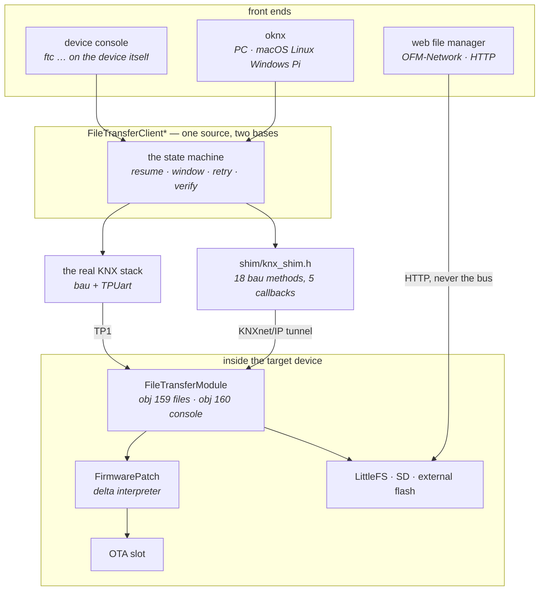
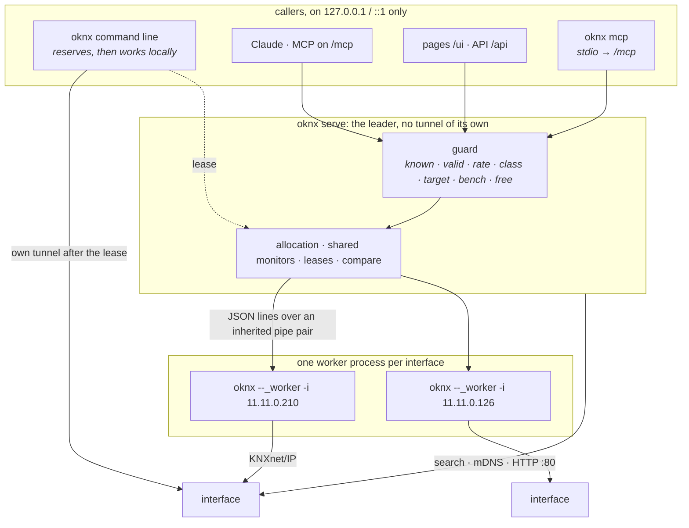

# Architecture

**For:** developers integrating, extending or debugging the module. How the pieces fit and why the
transport looks the way it does. The command surface itself is in [PROTOCOL.md](protocol.md).

## The pieces



Two things this picture is meant to settle. **The client is not written twice** -- `FileTransferClient*`
is compiled unchanged for the device and for the PC; only what it stands on differs, and that base is a
contract, not a port ([host-shim.md](host-shim.md)). And **the web file manager never touches the bus**;
it writes through the same drives over HTTP, which is why it is fast and why that speed cannot be
carried over ([../guide/throughput.md](../guide/throughput.md)).

## The path of a file

```
   PC                               KNXnet/IP                    TP1 bus            Device
  ────                             ───────────                  ─────────          ────────

  oknx                                                                         FileTransferModule
   │                                                                                    │
   │  FileTransferClient  ──┐                                                           │
   │  (the same source                                                                  │
   │   as in the device)    │                                                           │
   │                        ▼                                                           │
   │              ┌──────────────────┐      UDP 3671      ┌───────────┐   ~400 B/s      │
   └─────────────▶│  KnxIpTunnel     │───────────────────▶│ Interface │────────────────▶│
                  │  (oknx/src)      │◀───────────────────│           │◀────────────────│
                  └──────────────────┘                    └───────────┘                 │
                                                                                        ▼
                                                            LittleFS  ·  SD  ·  ExtFlash
```

The tunnel carries **every** PA on the bus — one interface is enough to reach any device. What limits
the pace is not the tunnel but the TP1 line behind it and the device at the end
([THROUGHPUT.md](../guide/throughput.md)).

## The transport is a call, not a stream

Every operation is **one** `A_FunctionProperty_Command` on an interface object:

```
   APCI 0x2C7   ┌──────┬──────┬───────────────────────────────┐
   command      │ 159  │ PID  │ payload              <= 247 B │
                └──────┴──────┴───────────────────────────────┘
                 object  command

   APCI 0x2C9   ┌──────┬──────┬──────┬────────────────────────┐
   answer       │ 159  │ PID  │ code │ payload                │
                └──────┴──────┴──────┴────────────────────────┘
```

Two objects, two separate worlds:

| Object | for | session |
|---|---|---|
| **159** | files, directories, firmware, access protection ([PROTOCOL.md](protocol.md)) | none — every command stands alone |
| **160** | the console ([CONSOLE.md](../guide/console.md)) | one, with OPEN and CLOSE |

## One client, one state machine

`FileTransferClient` is a **singleton**: `ftcOnResponse` is static and forwards to `instance()`. One
per process, and it can do exactly **one** thing — send **or** list a directory **or** delete.

That is not an oversight, it matches the other end: there stands **one** device with **one** open file
(`_file`), and two concurrent streams run it over. Whoever needs concurrency starts a second process,
not a second client.

## What runs in the device, and when

```
  KNX dispatch (close to the interrupt)   loop()  (cooperative, under freeLoopTime)
  ─────────────────────────────────────   ────────────────────────────────────────
  processFunctionProperty()               conLoop()         run a parked console line
    ├─ recognise the command              crcLoop()         one slice of a file checksum
    ├─ one file operation                 deltaLoop()       one slice of a firmware rebuild
    └─ return the answer                  probeLoop()       one slice of the source checksum
       -- nothing long here --
```

**Nothing long in the dispatch.** A checksum over 500 KB would stall the KNX stack and reboot the
device. That is why `FileInfo` answers "still computing" the first time and the checksum runs across
many `loop()` passes ([PROTOCOL.md](protocol.md)).

## Drives

A prefix in the path selects the target, the same way everywhere:

| Path | drive | checksum |
|---|---|---|
| `/file.bin` | LittleFS (internal) | always, computed cooperatively |
| `sd/file.bin` | SD card | on request only |
| `efc/file.bin` | external flash | on request only |

Routing happens in exactly one place (`ftmDrive`), and **a rename never crosses a drive boundary** —
moving between drives is a copy plus a delete.

## The same client on both sides

```
  Device                                   PC
  ──────                                   ──
  FileTransferClient.cpp   ◀── identical ──▶   FileTransferClient.cpp
  knx.bau()                                    oknx/src/      →  KnxIpTunnel
  serial console `ftc …`                       argv  →  the same command parser
```

The PC client carries **no** protocol logic of its own. It only provides a base (`shim/`) that maps
`knx.bau()` onto a KNXnet/IP tunnel. What works on the device therefore works on the PC — and a
protocol bug shows on both sides instead of hiding between two implementations.

Built for eight targets; the list and the build itself are in [oknx.md](../guide/oknx.md).

## oknx serve

`oknx serve` lets Claude, pages, scripts and the command line share the interfaces of one machine. How to run
it is in [serve.md](../guide/serve.md), the operations in [serve-operations.md](serve-operations.md). This part
is how it is built.



**Leader and workers.** The leader holds HTTP, MCP, the guard and the bookkeeping. It opens no tunnel; it does the
KNXnet/IP search and mDNS for `discover` and reads and writes the interfaces' firmware pages over HTTP itself. Each
interface in use gets a worker, `oknx --_worker -i <ip> --port <p>`, started with stdin/stdout on one inherited
pipe pair and stderr on its log file; nothing else is inherited (POSIX: every other descriptor closed; Windows: a
handle list with exactly those three). In a worker the management tunnel
runs in one thread, the only one that touches the client's globals, one operation at a time; every monitor has
its own thread and socket, so a slow operation never holds back a monitor's acknowledgements. An idle tunnel is
closed after 5 s.

**The pipe.** One JSON line per message, at most 1 MiB: `job`, `cancel`, `mon`, `mgmt_close`, `bye` to the worker;
`hello`, `progress`, `result`, `frame`, `lost`, `mon`, `mgmt_closed` back. One writer per worker sends from two
queues: control lines are never dropped, telegrams are bounded (20000); an overflow drops the oldest and sends
`lost` with the span, before the next item of that stream. A dying worker is seen at its pipe: the operation it
was running ends `INTERNAL`, queued ones go to the next worker, its monitors end. It writes its connections to a
state file every 5 s, and the next worker for that interface sends `DISCONNECT_REQUEST` for every entry younger
than 110 s (an interface drops a silent one after 120 s, 03_08_02 5.4).

**Allocation.** A busmonitor excludes every other tunnel on its interface (03_08_04 2.2.4), so it is opened once
and shared; so is a group monitor. Each reader has its own queue (4000); one that overflows for 30 s is closed,
never silently thinned. A monitor without readers lingers 3 s. Management operations run one after another per
interface. A reservation of the command line is one open HTTP request: it ends when the process ends; a
busmonitor reservation conflicts with everything on its interface, two management ones do not. A plain `bm` of
the command line reads along a busmonitor serve holds.

**Guard.** Every call, from MCP, the API or a page, passes the same checks in this order, and the first refusal
answers: operation known, arguments valid against its schema, rate, class allowed on the interface, target allowed
(write lines, group address lists, protected targets, setpa line), bench free, connection free. The rules are one
immutable snapshot the guard takes once (the rate limit reads the current limit); `PUT /api/rules` checks a new
file with the same loader, keeps the old one as `.bak` and swaps the snapshot, so a call never sees half of each.

**Bench lock.** `oknx bench lock` holds the bench with a JSON file; the test suite is to write the same file and
does not yet:
`{"version": 1, "run", "host", "pid", "start", "interfaces": [...], "heartbeat"}` (times in UTC, ISO 8601). The
holder renews `heartbeat` every 10 s; the lock is valid on the machine it names (a lock without `host` on any
machine) while the heartbeat is less than 60 s old or up to 15 s ahead. serve checks it every 2 s, stops its
monitors, operations and connections on the named interfaces and answers `BENCH_LOCKED` there to everything but
passive operations. A process started with `OKNX_BENCH_RUN` set does not reserve at serve (meant for the suite
run).

**MCP.** `/mcp` answers 2026-07-28 (`_meta` protocol version, mirrored headers, no session, closing the stream
cancels) and 2025-03-26 to 2025-11-25 (`initialize`, `Mcp-Session-Id`, `notifications/cancelled`). A long call
answers as SSE: a comment every 2 s, progress at least every 25 s when asked for. A result over 60000 bytes of JSON
comes as a summary plus the resource `oknx://results/<id>`. No MCP operation changes the rules or the key.

**Access.** Only loopback with serve's own Host; another site's Origin or a cross-site fetch is refused, also with
the key. Programs send the key of `serve.key` (owner-only); a browser gets an HttpOnly, SameSite=Strict session
from a one-time link (60 s, once; 12 h at most, 1 h idle). An FTC password comes from serve's environment or its
terminal, never over the API.

**One implementation.** Group reads and writes, property reads, run state, restart and setpa are in
`core/GaOps.h`, `core/PropRead.h` and `core/SetPa.h`; the command line and the worker call the same code, and
`Monitor`/`Compare` take a feed instead of a tunnel when serve hands them the telegrams.
